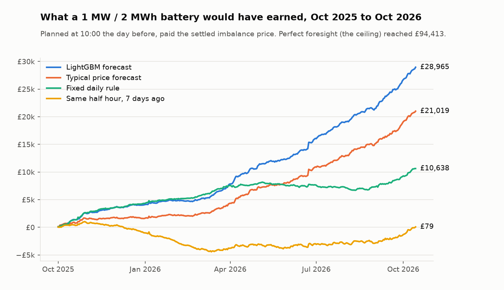
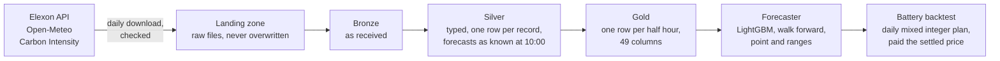

# Chargecast
UK electricity price forecasting and battery trading backtest

[](https://github.com/umarkhan0206/uk-power-pipeline/actions/workflows/tests.yml)

**Live dashboard:** [umarkhan0206.github.io/uk-power-pipeline/dashboard](https://umarkhan0206.github.io/uk-power-pipeline/dashboard/)
(every test day, and a replay of what the battery did on any of them)

A data pipeline that collects two years of Great Britain electricity market data, forecasts
the next day's half hourly imbalance price at 10:00 the day before, and tests what those
forecasts are worth to a grid battery.

**Headline:** in a year long walk forward backtest, a battery trading on the LightGBM forecast
earned **38% more** than one using the best simple forecast, and **2.7 times** a fixed daily
schedule, with every input checked to have been published before the decision.



## Results

All results are on a test year the models never trained on (1 October 2025 to
14 October 2026), retrained monthly using only the past.

**Forecast accuracy** (17,938 half hours, £/MWh, lower is better)

| Method | MAE | RMSE |
|---|---|---|
| Same half hour 7 days ago | 44.53 | 63.36 |
| Typical price for the time of day, last 28 days (the bar) | 33.30 | 47.20 |
| **LightGBM on the distance from the typical price** | **29.83** | **41.25** |

10.4% better MAE and 12.6% better RMSE than the bar, winning 11 of 13 months.
Its 10 to 90% ranges score 13.9% better (pinball loss) than ranges from the same 28 days.

**Battery backtest** (1 MW / 2 MWh, 88% round trip, 379 days)

| Strategy | Profit | Share of perfect foresight | Losing days |
|---|---|---|---|
| Perfect foresight (the ceiling) | £94,413 | 100% | 0 |
| **LightGBM forecast** | **£28,965** | **30.7%** | 108 |
| Typical price forecast | £21,019 | 22.3% | 136 |
| Fixed rule: charge 02:00 to 04:00, discharge 17:00 to 19:00 | £10,638 | 11.3% | 139 |
| Same half hour 7 days ago | £79 | 0.1% | 217 |

A forecast only 10% more accurate made 38% more money, because a battery needs the order
of cheap and expensive hours more than the exact price. The ranking holds without the five
best days. Two other lessons: the 7 days ago forecast is only 34% worse on MAE but earns
almost nothing, and the fixed rule keeps pace through winter (the chart's lines run together
until March), when the evening peak is reliable, then falls away.

Details: [`docs/experiments.md`](docs/experiments.md) and [`docs/backtest.md`](docs/backtest.md).

## How it works



* **Ingestion** (`src/ukpower/ingestion`): 11 sources, an HTTP client with retries, backoff
  and rate limiting, a check on every response, and an append only landing zone. Recent days
  are fetched again to catch republished data; settled prices look back 430 days every
  Sunday to capture later settlement runs.
* **Lakehouse** (Databricks Free Edition, Delta Lake, PySpark; notebooks in `databricks/`):
  Bronze keeps data as received, Silver keeps the latest version of measured data and the
  forecast that was available at 10:00, Gold joins it all into one row per half hour.
* **Forecasting** (`src/ukpower/forecast`): baselines, LightGBM median and quantile models,
  monthly walk forward folds, MAE, RMSE, coverage and pinball loss.
* **Backtest** (`src/ukpower/backtest`): each day's plan is the most profitable schedule for
  the forecast within the battery's limits (never charging and discharging at once), locked
  at 10:00, then paid the settled price.

## Why the numbers can be trusted

* **The 10:00 rule.** Forecasts for day D are made at 10:00 UK time on day D-1. Every input
  must have been published before then. Where a source records publish times, the code
  checks it and Gold has zero inputs from after the decision; prices republished late
  (1,074 values) are blanked. Where it does not (the traded price), only days up to D-2 are
  used, about 10 hours before the decision.
* **Walk forward testing.** Each month is forecast by a model trained only on earlier days,
  with a 2 day gap. Nothing is shuffled.
* **Fixed settings and a written log.** Model settings were fixed before any result was seen.
  Every variant tried is in [`docs/experiments.md`](docs/experiments.md) with its score,
  including the ones that did not help (5 forecast variants in total).
* **Pre-registration.** A risk control for the battery (plan with cautious 25% and 75% price
  levels) was committed to git before it was run. It cut losing days from 108 to 28 but
  earned 43% less, so it was reported and not adopted.
* **Tests.** 293 tests run on every push, including the battery's physics (never above full,
  never below empty, energy in minus losses equals energy out).

## Data findings along the way

* **The price feed and the settled price differ.** The published imbalance price matches the
  final settled price in 95.8% of half hours. Of 177 half hours at exactly £0.00, 30 were not
  real: the settled price was up to £164.99. The model learns from the settled price.
* **Old versions are not kept.** Elexon's price feed only returns the latest version, so the
  pipeline captures settlement runs (II, SF, R1 to RF) itself and builds the revision history.
* **The traded price explains the drift.** Prices rose about 75% during the test year.
  The exchange traded price (only one of two exchanges reports real trades) tracks the
  imbalance price's monthly level closely, and adding it improved the model that had no
  sense of level by 6.3%.
* **The official day ahead solar forecast is published after 10:00,** so it cannot be an input;
  archived ECMWF weather forecasts are used instead, falling back to the newest complete
  earlier run when one is missing.

## Limits

This is one revenue stream, not a business case: the battery is paid the imbalance price
only (no day ahead, intraday or grid service income), its plan is not adjusted during the
day, fees are ignored, and it is assumed too small to move prices. Perfect foresight is
unreachable a day ahead; the comparison that matters is against the alternatives. All
results come from one test year; a forward test on new data is planned.

## Running it

Requires Python 3.11.

```bash
python -m venv .venv
# Windows: .venv\Scripts\activate    macOS/Linux: source .venv/bin/activate
pip install -e ".[dev,model]"
pytest
```

```bash
python -m ukpower.ingestion.cli incremental          # download new and recent days
python -m ukpower.ingestion.cli backfill --start 2024-10-01
python -m ukpower.forecast.evaluate                   # needs data/gold/price_features.parquet
python -m ukpower.backtest.run
python scripts/make_charts.py
python scripts/publish_results.py                     # writes results/ for the dashboard
python scripts/build_dashboard.py                     # writes docs/dashboard/index.html
```

Bronze, Silver and Gold are built in Databricks from the notebooks in `databricks/`, and Gold
is exported to `data/gold/price_features.parquet`. Settings live in
[`config/settings.yaml`](config/settings.yaml).

## Project layout

```
config/          settings
dashboard/       dashboard page template
databricks/      Bronze, Silver and Gold notebooks
docs/            data sources, lakehouse, experiments, backtest
docs/dashboard/  the built dashboard, served by GitHub Pages
results/         published forecasts and daily battery profits
scripts/         charts, published results and the dashboard build
src/ukpower/     ingestion, forecast and backtest packages
tests/           unit tests and real API fixtures
```

## Data sources

* [Elexon Insights API](https://data.elexon.co.uk/bmrs/api/v1): prices, settlement runs,
  traded prices, demand, generation and forecasts
* [Open-Meteo](https://open-meteo.com/) Single Runs API: archived ECMWF weather forecasts
  (non commercial use)
* [National Grid ESO Carbon Intensity API](https://api.carbonintensity.org.uk)

## Next

Automated daily runs, data quality checks and monitoring, and a forward test on days
collected after the model was frozen.
